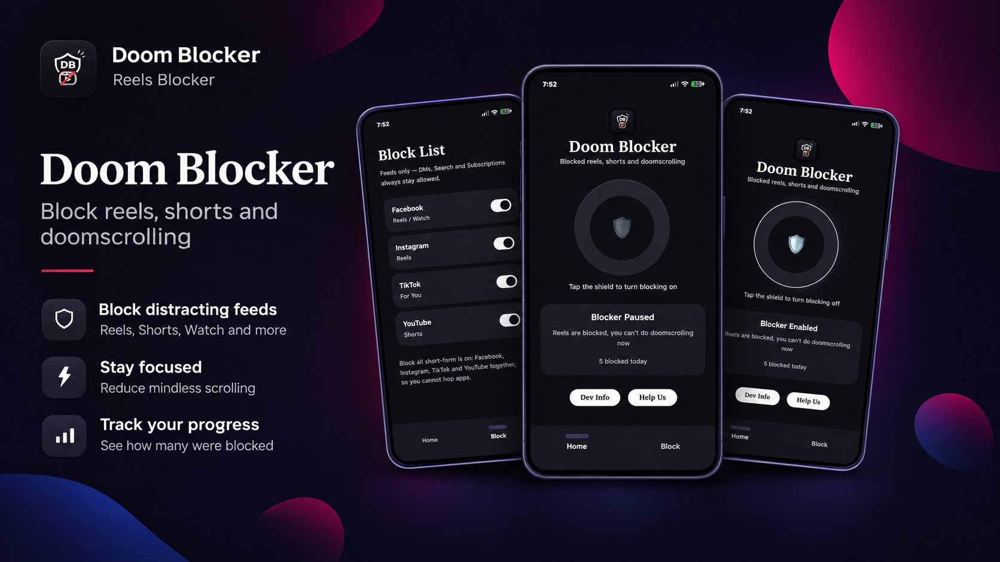

# Doom Blocker

> A simple app with one job: stop the scroll.

**Completely free. No ads, ever.**

## About

Doom Blocker exists for a single purpose — blocking reels, shorts, and endless scrolling.

It doesn't try to be the flashiest app or pack in a dozen features. It does one thing, and it does it well.

I built it on my own because I needed it myself — to break the habit of doomscrolling and spend less time drifting through social media without thinking. It's a small project with a simple purpose, and I hope it helps you take back some of your time, too.

## What it blocks

- Facebook Reels
- Instagram Reels
- TikTok For You
- YouTube Shorts

## How it works

Doom Blocker uses Android's Accessibility service to catch a reel or short the moment it opens, and sends you back to the app's main screen. No root, no VPN, no extra permissions — just Accessibility.

It has no ads and no tracking. It works offline, and it only goes online to check for a new version.

## Download

Get the latest APK from the [releases page](https://github.com/dhrubonai/Doom-Blocker-Releases/releases/latest). Android 10 and newer.

## If it helped you

If Doom Blocker helped you take back some of your time, give the project a star and share it with someone else who keeps falling into the scroll. It costs nothing, and it keeps this little project alive.

Free forever, with no ads. A little support keeps it alive — and free for everyone.
